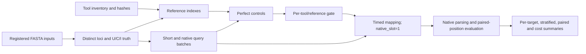

# MOSAIC Benchmark

A reproducible DNA alignment benchmark built from **different genomic loci**, with
known source coordinates and generating edit paths. The default design compares
minimap2, LAST, LASTZ, BLASTN, FastGA, and **original Bowtie 1**, using isolated
queries and the same targets embedded in native cross-species background.

This repository contains runnable code and a single Snakemake workflow. It does
not include genomes, historical workstation results, or claims that the full
production benchmark has already run. Start with the synthetic demo.

## Fixed design

- Six references: *B. subtilis*, *S. pombe*, *D. melanogaster*, complete zebrafish
  and mouse assemblies, and **human chromosome NC_000022.11 only**. See the exact
  accessions, URLs, and SHA256 values in `config/references.json`.
- Lengths: 150, 250, 500, 1000 bp. **1000 different, non-overlapping source loci
  per reference per length**, including different starts across lengths: 24,000
  loci overall. These are not 1000 mutations of each of20 source fragments.
- Nominal identities: 50–90% in5-point steps; 92,94,96,98,100%.
- One variant per locus/model/identity. U/C/I are equally represented. C has one
  fixed setting: **h=50%, a=80%, w=10%**. There is no eight-preset allocation.
- 936,000 nonperfect short queries and24,000 canonical perfect controls before
  exact-sequence aliases. P100 records stand for the identical U/C/I controls;
  perfect controls do not enter the mutation macro average.
- Background confirmation uses 150 and 1,000 bp at 50%, 60%, 70%, 80%, 90%,
  and 94% identity. Each reference × length × edit model × identity condition
  uses all 1,000 distinct source loci, with four targets per composite and
  10,000 bp of native *Arabidopsis* background. The design yields **54,000
  composite queries** and 216,000 target evaluations per eligible tool. Their
  short counterparts come from the same benchmark inputs.
- Exactly two conditions, `short` and `native`. **No shuffled/Euler background**.

The main outcome is `region90`: both query-fragment and reference-source coverage
by actual aligned base pairs reach90%, on the correct reference record, strand,
and source region. Each contributing native alignment must independently contain
at least100 paired bases before truth-region clipping. See [methods](docs/methods.md)
for definitions, integer budgets, seeds, and limitations. The100bp threshold is
explicit and configurable; scientific suitability still needs sensitivity review.

## Install

Linux, Python3.11+, GNU `time`, and the six native toolchains are required.

```bash
mamba env create -f environment.yaml
conda activate mosaic-benchmark
bash scripts/build_fastga.sh
export PATH="$PWD/tools/fastga:$PATH"
```

Alternatively, install the Python workflow with `python -m pip install '.[workflow]'`
and provide native executables yourself. Configure absolute executable paths in
`config/benchmark.json` under `executables` if they are not on PATH.

`build_fastga.sh` checks out upstream commit
`178afcbba2f79abc1686e3bd2b8a916969467e83` and applies the supplied, explicitly
named empty-worker initialization patch. Results are labeled as that compatibility
build; it is not silently presented as an unchanged upstream executable. Original
Bowtie is pinned to1.3.1 in the environment; Bowtie2 is not substituted. A runtime
inventory captures versions, binary/helper hashes, full policies, and hardware.
The conda solver may select different versions of the other native tools; retain
`toolchain.json` and export the resolved environment for exact reruns.

## Run the small demonstration first

```bash
python -m unittest discover -s tests -v
python scripts/make_demo.py --directory work/demo
mosaic plan --config work/demo/config.json
mosaic run --config work/demo/config.json --dry-run
mosaic run --config work/demo/config.json --foreground
```

The synthetic demo has16 distinct source loci, all four lengths, both strands,
70% U/C/I, perfect controls, and six planted long samples. It exercises all six
tools and parsing/evaluation. It is an interface fixture, not biological evidence.
The exact number of calls and their statuses are obtained from its receipts.

## Production workflow

Run from the repository directory. Public downloads are explicit, checksum-pinned,
and may require several GB of transfer/storage. No downloads occur during mapping.

```bash
mosaic fetch-references --manifest config/references.json --directory data
mosaic plan --config config/benchmark.json
mosaic run --config config/benchmark.json --dry-run
mosaic run --config config/benchmark.json
mosaic logs --config config/benchmark.json
```

`run` defaults to an independent **systemd user service**, surviving the terminal
or agent session. Its printed response gives absolute log, service, submission,
and exit paths. On machines without a user systemd manager, explicitly use
`--foreground`, for example in a scheduler allocation. `resume` uses the same
workflow and `--rerun-incomplete`; active submissions are returned instead of
starting a second supervisor. A run-directory lock prevents concurrent writers.

The full DAG is:



The default production batches are64 short records or one composite query.
They are declared settings, **not a claim that every six-reference/tool combination
has already passed its resource gate**. Perfect controls precede mutated queries;
all-attempt cumulative budget checks enforce the configured cap. A timeout-bound
printed by `plan` is not an estimated duration. Production must first be qualified
on the intended workstation. The default72h cap is a new deployment limit, not a
transfer or reset of any historical study budget.

Original Bowtie supports reads up to1024bp and ungapped alignment. This protocol
therefore evaluates it on short queries; the intact10kb-background records are
reported as **NOT_SUPPORTED**, with missing recovery rather than invented zeroes.
There is no splitting, clipping, or Bowtie2 fallback. Within the supported length
range, the fixed `-v3` policy's valid no-hit outputs count as non-recovery, including
its expected sensitivity limits on divergent or indel-containing sequences.

## Outputs and reproducibility

Under the configured `work_dir`:

- `dataset/`: per-batch FASTA/truth, source coordinates, background provenance,
  exact-sequence alias groups, perfect-model aliases, SHA256 manifest and seeds.
- `toolchain.json`: executable/helper identity, command policy, version output,
  FastGA build label, CPU model and available affinity.
- `indexes/`: separate native builds, index fingerprints and costs. FastGA also
  validates complete sequence readback from its GDB representation.
- `runs/<tool>/<batch>/`: commands, original output/partial output, stderr,
  GNU timing, return code, immutable numbered attempts, and per-target evaluation.
- `budget.json`: measured elapsed costs across attempts and any unfinished
  reservation. A reservation is not measured time. An unsettled interrupted
  invocation stops resumption until its evidence is reconciled.
- `summary/`: `per_query.tsv`, `grouped.tsv`, `paired_background.tsv`,
  `mapping_costs.tsv`, `index_costs.tsv`, and `summary.json`.
- `execution.log`, `execution_submission.json`, `execution_service.json`,
  `execution_exit.json`, and append-only `execution_history.jsonl`.

```bash
mosaic verify --config config/benchmark.json
python -m pip install '.[plots]'
mosaic plot --config config/benchmark.json
```

Figures use the measured grouped data, separate lengths, and consistent tool
colors. Reference construction, query-side FastGA preparation, mapping, and PAF
conversion are separately costed. Failed and timed-out supported positive searches
remain in denominators. Missing input, unsupported tasks, failed controls, and
technical index/conversion failure are distinct states.

See [methods](docs/methods.md), [workflow operation](docs/workflow.md), and
[validation scope](docs/validation.md). This implementation does not claim natural
orthology, certified family independence, natural false-positive rates, or a
complete explanation of the background effect.
